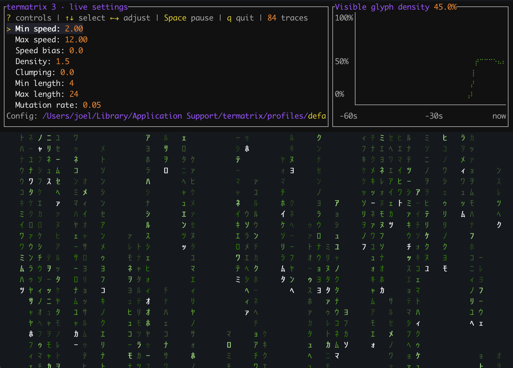
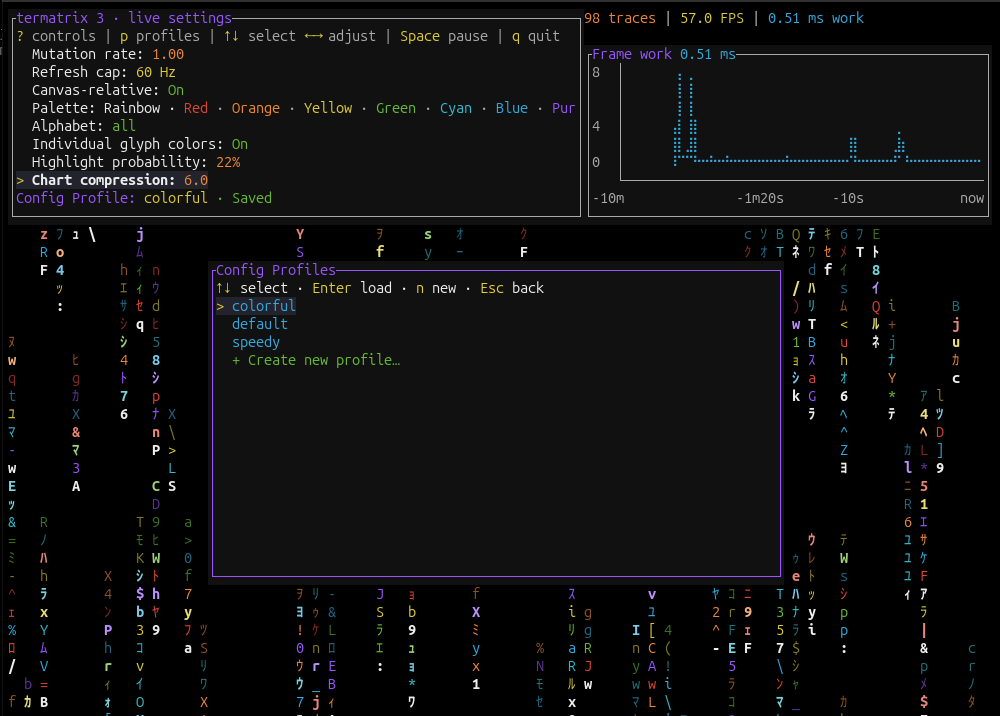

# termatrix

Matrix rain for your terminal, with live controls, layered traces, and colorful
highlights. Tune the look while it runs—your preferences save automatically.



*Captured in iTerm on macOS. Fonts and appearance vary by terminal.*

## Install and run

```sh
cargo install termatrix --locked
termatrix
```

Use a truecolor terminal and a font with halfwidth Katakana support. Linux,
macOS, and Windows are supported by the terminal backend; this release has been
visually checked by the developer on their terminal. Run `termatrix --help` for options.

## Controls

| Key | Action |
| --- | --- |
| `?` | Show or hide controls |
| `p` | Select or create a configuration profile |
| `c` | Manage palettes and choose which appear in cycling |
| `↑` / `↓` | Select a setting |
| `←` / `→` | Adjust the selected setting |
| Space | Pause or resume |
| `q`, Esc, Ctrl+C | Quit |

Adjust speed, density, clumping, trace length, alphabet, palettes, and highlights.
Choose Green, Blue, Red, Purple, Yellow, Orange, or Grey gradients; try Rainbow,
Christmas, or a mixed palette. Enable **Individual glyph colors** to mix colors
within each trace. The default is green Katakana with scattered highlights and one color per trace.

Traces fade from a white head through their primary color toward black.
Use `--theme light` for black heads fading through color toward white, or
`--theme dark` to select the dark-theme fade. The rain preserves your terminal background. The default `--theme auto` reads
`COLORFGBG` and falls back to dark; `TERMATRIX_THEME` also sets the theme.
Truecolor terminals get smooth gradients; 256-color and basic ANSI terminals
get stepped approximations. Existing highlighted glyphs interrupt the fade.

The controls resize with your terminal. The performance section shows trace count,
actual FPS, and frame work time. Wider terminals add Braille charts for frame work,
coverage, and trace count, sharing ten minutes of history and adjustable time
compression. Press `?` for a full canvas.

## Preferences

Settings live in your platform's configuration directory under
`termatrix/profiles/default.toml`—usually
`~/.config/termatrix/profiles/default.toml` on Linux or
`~/Library/Application Support/termatrix/profiles/default.toml` on macOS.
The file is created on your first change.

```sh
termatrix --config ./my-rain.toml
termatrix --glyph-set binary --colors bB
termatrix --max-refresh-rate 30
```

See the [user guide](https://github.com/joeledwards/termatrix/blob/master/docs/guide.md) for settings, custom palettes, and upgrading
from 2.x. Startup overrides are included in the next automatic save.

## Profiles

Save different looks as named profiles and switch between them while the animation
runs. Press `p` to open the profile picker, use `↑` / `↓` to select a profile,
and press Enter to load it. Press `n` inside the picker to save your current
settings under a new name, or Esc to return to the animation.



## Custom palettes

Press `c` to open the palette manager. Use `n` to create a named palette from
existing color codes, `e` to edit a custom palette, and Space to show or hide a
palette in the Palette setting. Names preview their colors, and the rain previews
selections live. Enter applies a palette; Esc returns without changing your choice.
Custom palettes support repeated codes for weighting. Built-ins can be hidden;
custom palettes can also be deleted. See the [palette guide](https://github.com/joeledwards/termatrix/blob/master/docs/guide.md#palette-manager).

## Development

```sh
cargo test --lib --bins
cargo fmt --check
cargo clippy --lib --bins -- -D warnings
```

See [design](https://github.com/joeledwards/termatrix/blob/master/docs/design.md), [test coverage](https://github.com/joeledwards/termatrix/blob/master/docs/coverage.md), and
[release checks](https://github.com/joeledwards/termatrix/blob/master/docs/releasing.md). The animation library is independent of the
terminal frontend; future graphical frontends can use the same scene model.

Inspired by and originally forked from [rustmatrix](https://github.com/meganehouser/rustmatrix).
Version 3 is a complete rewrite. Licensed under [ISC](https://github.com/joeledwards/termatrix/blob/master/LICENSE).
